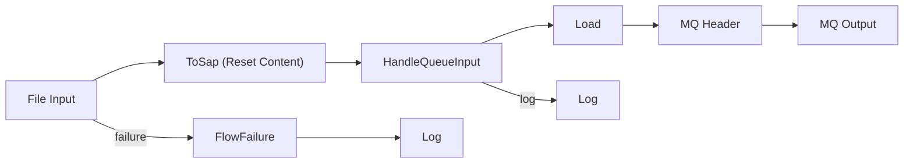
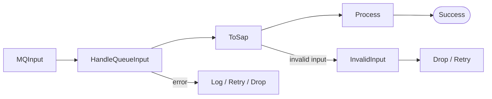

# SapOrderAckAdapter

## Overview

The SapOrderAckAdapter receives order acknowledgement messages from SAP and feeds them into the internal integration landscape, supporting the outgoing order confirmation process toward trading partners. Acknowledgement files are picked up from a network share (or arrive via publish/subscribe), evaluated against configurable error, overrule, and priority translation tables, archived as XML and PDF, and announced to the B2B event system.

## Architecture

### Components

The adapter consists of two main message flows:

1. **LoadOrderAck** - File input flow
2. **ProcessOrderAck** - Queue processing flow

### Dependencies

- **MapHelperLib** - Translation and mapping utilities
- **SapMessageLibrary** - SAP message definitions
- **CoreAdapterLib** - Common adapter patterns (MQInput, MQRetry, MQDrop, HandleQueueInput)
- **EventBridgeLib** - B2B event creation
- **AuditLogLib** - Centralized logging
- **ColdStoreLib** - File archiving

## Flows

### Flow 1: LoadOrderAck

#### Purpose
Loads acknowledgement files from a network directory and places them on an MQ queue for processing.

#### Flow Design



#### Key Components

1. **File Input** ([`LoadOrderAck.msgflow:22`](SapOrderAckAdapter/LoadOrderAck.msgflow:22))
   - Monitors: `\\fileserver\dfs\ExampleCorp\Applications\{ENV}ESB\Adapter\Load\SAP\Acknowledgement`
   - Pattern: `*` (all files)
   - Configurable via deployment properties

2. **ToSap** ([`LoadOrderAck.msgflow:25`](SapOrderAckAdapter/LoadOrderAck.msgflow:25))
   - Resets content descriptor to XMLNSC domain
   - Sets message set to `{SapMessageLibrary}`

3. **Load Compute Node** ([`LoadOrderAck.esql:3-32`](SapOrderAckAdapter/LoadOrderAck.esql:3-32))
   - Logs input metadata (type, status, activityId, messageType, sender, receiver)
   - Sets message persistence to persistent (`OutputRoot.Properties.Persistence = 1`)
   - Copies entire message to output

4. **MQ Output** ([`LoadOrderAck.msgflow:43`](SapOrderAckAdapter/LoadOrderAck.msgflow:43))
   - Target queue: `ADPT.SAP.ORDERACK.IN`
   - MQMD settings: Unicode charset, persistent, datagram type

#### Configuration

| Property | TEST | PROD |
|----------|------|------|
| inputDirectory | `\\fileserver\dfs\ExampleCorp\Applications\TestESB\Adapter\Load\SAP\Acknowledgement` | `\\fileserver\dfs\ExampleCorp\Applications\ProdESB\Adapter\Load\SAP\Acknowledgement` |
| filenamePattern | `*` | `*` |
| Log_ElasticPrefix | `adpt-sap-orderack-outgoing-load` | `adpt-sap-orderack-outgoing-load` |


### Flow 2: ProcessOrderAck

#### Purpose
Processes acknowledgement messages from the queue, determines error status, archives files, and creates B2B events.

#### Flow Design



#### Key Components

1. **MQInput** ([`ProcessOrderAck.msgflow:40`](ProcessOrderAck.msgflow:40))
   - Source queue: `ADPT.SAP.ORDERACK.IN`
   - Uses CoreAdapterLib MQInput subflow

2. **HandleQueueInput** ([`ProcessOrderAck.msgflow:43`](ProcessOrderAck.msgflow:43))
   - Standard queue input handling
   - Routes to Log, Retry, or Drop based on processing status

3. **Process Compute Node** ([`ProcessOrderAck.esql:10-271`](ProcessOrderAck.esql:10-271))
   - **Main processing logic** - Most complex component
   - Clears translation cache (5-minute default)
   - Logs input with correlation details
   - Determines error status from apply report
   - Archives XML and PDF files
   - Creates B2B event pairs (Received/Sent)

### Error Handling Logic

The adapter implements sophisticated error handling with three key concepts:

#### 1. Error Determination ([`ProcessOrderAck.esql:64-129`](ProcessOrderAck.esql:64-129))

Processes acknowledgements based on message type:

| Message Type | Main Table | Priority Table |
|--------------|------------|----------------|
| OrderTypeA | ERR_TABLE_TYPE_A | PRIO_TABLE_TYPE_A |
| OrderTypeB | ERR_TABLE_TYPE_B | PRIO_TABLE_TYPE_B |
| OrderTypeC | ERR_TABLE_TYPE_C | PRIO_TABLE_TYPE_C |
| OrderTypeD | ERR_TABLE_TYPE_D | PRIO_TABLE_TYPE_D |
| Default | ERR_TABLE_DEFAULT | PRIO_TABLE_DEFAULT |

**Logic Flow:**
1. Finds first `Failed` ApplyResult
2. Iterates through ApplyResultMessages
3. Records error codes and descriptions
4. Checks if error is overruled
5. Checks if error is prioritized (stops iteration if true)
6. Falls back to warnings if no errors found

#### 2. Overruled Errors ([`ProcessOrderAck.esql:131-155`](ProcessOrderAck.esql:131-155))

Errors can be overruled (treated as successful) via translation tables:

- **Recipient-specific**: key `ERR{messagekey}:{recipient}` resolves to `{errorCode}`
- **Global**: key `ERR{messagekey}` resolves to `{errorCode}`
- Checks both message-specific table and default `ERR_TABLE_DEFAULT` table

**Important behavior**: If ANY error is overruled, the entire acknowledgement is treated as APPLIED, even if other non-overruled errors exist.

#### 3. Prioritized Errors ([`ProcessOrderAck.esql:157-181`](ProcessOrderAck.esql:157-181))

Certain errors take precedence and stop further processing:

- **Recipient-specific**: key `{messagekey}:{recipient}` resolves to `{errorCode}`
- **Global**: key `{messagekey}` resolves to `{errorCode}`
- Checks both message-specific table and default `PRIO_TABLE_DEFAULT` table

When a prioritized error is found, it's immediately returned without checking remaining messages.

### Archiving ([`ProcessOrderAck.esql:183-220`](ProcessOrderAck.esql:183-220))

Archives both XML and PDF files:

**Directory Structure:**
```
{AcknowledgementArchiveDirectory}\{Recipient}\yyyy\MM\dd\
```

**Files Created:**
- `{ActivityId-without-dashes}.xml` - Original XML message
- `{ActivityId-without-dashes}.pdf` - Base64-decoded PDF from attachment

**Example:**
```
\\fileserver\dfs\ExampleCorp\Applications\TestESB\Inhouse\Archive\OrderAck\PARTNER01\2026\02\19\
  ├── 123e4567e89b12d3a456426614174000.xml
  └── 123e4567e89b12d3a456426614174000.pdf
```

### B2B Event Creation ([`ProcessOrderAck.esql:222-256`](ProcessOrderAck.esql:222-256))

Creates two B2B events per acknowledgement:

#### Event 1: "Received"
- Status: `Received`
- Error info: Only if error exists (not overruled)
- Marks message receipt from SAP

#### Event 2: "Sent"
- Status: `Sent`
- Error info: Always included (even if overruled)
- Marks completion of processing
- Sets `Completed = 'yes'`

**Common Event Fields:**
- SubType: `Ack`
- Direction: `Outgoing`
- Destination: `SAP`
- Format: `XML`
- FromPartner: `ACK`
- ToPartner: `{Recipient}`
- MessageType: `Acknowledgement`
- AckGUID: `{ActivityId}`
- AckCorrelationId: `{CorrelationId from message}`
- Location: PDF archive path
- AdditionalInfo: Error code and description

### Retry Configuration

| Parameter | Default | Description |
|-----------|---------|-------------|
| ShortRetryCount | 1 | Number of immediate retries |
| ShortRetryIntervalSeconds | 1 | Delay between short retries |
| LongRetryCount | 1 | Number of delayed retries |
| LongRetryIntervalSeconds | 30 | Delay between long retries |
| RetryMessagePriority | 9 | MQ priority for retry messages |

---

## MQ Configuration

### Queue Definition ([`queues.mqsc:1`](SapOrderAckAdapter/queues.mqsc:1))

```mqsc
DEFINE QLOCAL(ADPT.SAP.ORDERACK.IN) 
  DESCR('SAP Order Acknowledgement Input') 
  MAXMSGL(104857600)  -- 100 MB max message size
  DEFPSIST(YES)       -- Persistent by default
```

### Subscription ([`queues.mqsc:3`](SapOrderAckAdapter/queues.mqsc:3))

```mqsc
DEFINE SUB('SAP Outgoing OrderAck') 
  TOPICSTR('SAP/INHOUSE/OrderAck/#') 
  DEST('ADPT.SAP.ORDERACK.IN') 
  SUBUSER(SYSTEM)
```

**Note:** Replaces legacy subscription to `LEGACY.XML.ORDERACK.IN(.U)`

---

## Logging Strategy

### Log Points

1. **Load Flow**
   - Input logging with message metadata
   - Flow failure logging

2. **Process Flow**
   - Input logging with correlation details
   - Result logging (applied/overruled/error)
   - Archive operation logging
   - B2B event creation logging

### Elastic Search Integration

- Enabled by default (`Log_ToElastic = true`)
- Prefix: `adpt-sap-orderack-outgoing` (process) / `adpt-sap-orderack-outgoing-load` (load)
- Structured logging via AuditLogLib

---


## Operational Considerations

### Monitoring

1. **Queue Depth**
   - Monitor `ADPT.SAP.ORDERACK.IN` queue depth
   - Alert on sustained high depth

2. **Archive Growth**
   - Monitor archive directory size
   - Implement retention policies
   - Consider automated cleanup

3. **Error Rates**
   - Track overruled vs. actual errors
   - Monitor drop queue activity
   - Alert on high error rates

4. **B2B Event Delivery**
   - Ensure B2B events are being created
   - Monitor event processing in downstream systems

### Maintenance

1. **Translation Tables**
   - Document all translation tables used
   - Establish change control process
   - Test changes in non-production first

2. **Archive Cleanup**
   - Define retention periods
   - Implement automated cleanup scripts
   - Ensure compliance with data retention policies

3. **Configuration Management**
   - Keep deployment properties in version control
   - Document environment-specific differences
   - Test configuration changes thoroughly

### Dependencies and Integration Points

**Upstream systems:**
- **SAP** - Publishes acknowledgements to topic `SAP/INHOUSE/OrderAck/#`
- **File System** - Manual file drops to load directory

**Downstream systems:**
- **B2B Event System** - Receives acknowledgement events
- **Archive System** - Stores XML and PDF files
- **Logging/Monitoring** - Elastic Search for log aggregation

**Shared libraries:**
- **MapHelperLib** - Translation functions
- **SapMessageLibrary** - Message schemas
- **CoreAdapterLib** - Common patterns
- **EventBridgeLib** - Event creation
- **AuditLogLib** - Logging
- **ColdStoreLib** - File archiving


---

## Summary

The SapOrderAckAdapter is an ACE v12 application that bridges SAP acknowledgement messages into the internal integration landscape. Files are picked up from a network directory, queued, processed with type-specific error determination (including overrule and prioritisation tables), archived as both XML and PDF, and announced to the B2B event system as a `Received`/`Sent` event pair. Key operational characteristics: persistent MQ messaging, configurable short and long retry paths, Elastic Search log aggregation under the `adpt-sap-orderack-outgoing` prefix, and per-recipient day-partitioned archive directories.
